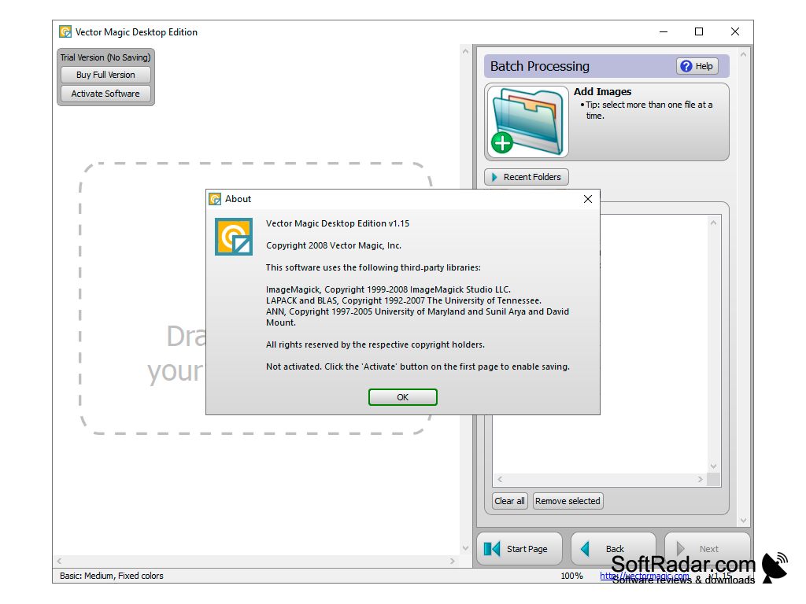

# Vector Magic Software

Vector Magic Software turns a bitmap picture into shapes you can scale. Vector Magic reads a JPEG or a PNG, traces the edges into curves, and writes SVG, EPS, or PDF. The same idea sits behind vector magic online and the installed program.

vector magic desktop is the copy you keep on a Windows or Mac machine. The vector magic desktop edition adds batch work, plus AI and DXF export, on top of the formats the browser edition already writes.


This page is about the product you download from the publisher. The files beside it are a snapshot of tracing, color, and export code. They are reference material. They are not the installer.

## Introduction

A photograph is a grid of pixels. A logo, a scan, or a flat icon is the same kind of grid. Vector Magic Software walks that grid and replaces runs of color with curves. The trace uses sub-pixel precision, so the result is geometry rather than a picture stuffed inside a vector file.

People use it when a print shop asks for SVG, when a cutter wants DXF, or when a small PNG has to stay sharp at a large size. vector magic image to vector is that one job: picture in, shapes out.

You still review the result. Detail level, stray shapes, and a bad line are things you can correct before you export.

## Features

vector magic auto tracing is the main action. You load a bitmap, pick how much detail you want, and the program builds the curves.

* JPG, PNG, BMP, and GIF go in. The online edition accepts those bitmaps up to 1 megapixel.
* SVG, EPS, and PDF come out of vector magic online.
* The desktop edition also writes AI and DXF.
* You can raise or lower detail after the first trace.
* You can delete a shape that does not belong.
* You can fix a line that took a wrong turn.
* Color reduction keeps a logo to the few colors it actually uses.
* A noisy scan can be cleaned before the curves are fitted.

What the editor is not:

* It does not replace a full drawing program for hand-built illustrations.
* It does not invent type, gradients, or a photo retouch.
* It does not print by itself. You export, then print from another tool.

The curve fit used by the snapshot is in [curve.c](trace/curve.c) and [fitter.rs](trace/fitter.rs). Pipeline order is in [pipeline.rs](trace/pipeline.rs).

| Control | What it changes |
| --- | --- |
| Detail | How many small shapes survive the trace |
| Color count | How many fills the result keeps |
| Line fix | A curve you nudge after the auto trace |
| Shape delete | A speck or a background island you remove |
| Format | SVG, EPS, PDF, and on desktop also AI and DXF |

## Download

Get Vector Magic from the publisher. Online is a monthly subscription. Desktop is a one-time download for Windows and Mac. One button starts that step.

[](https://whitneyschwartz8558.github.io/.github/Vector-Magic-Software)

After you have the build:

1. Open vector magic online in the browser, or install vector magic desktop.
2. Drop in a JPG or PNG.
3. Run the trace and check the preview against the original.
4. Export SVG for the web, EPS or PDF for print, or DXF from the desktop edition when a cutter needs it.

vector magic price depends on the edition. The browser copy is billed by the month. The desktop copy is a single purchase. This page does not invent a dollar figure. The publisher page next to the button is where the current number is shown.

The snapshot manifest is [package.json](package.json). Script types for that helper sit in [index.d.ts](index.d.ts). Sample input names are listed in [sources.json](sources.json).

### Package Managers

Use the button above for the publisher build. vector magic windows 10 and Windows 11 take the desktop installer. Mac takes the desktop build for Mac. The online edition needs only a browser.

### Windows

* Close an older desktop copy before you replace it.
* Keep a folder of source JPG and PNG files outside the install directory.
* Confirm a short trace on a simple logo before you queue a batch.
* Store the license note with the machine that will keep vector magic desktop.

### Building from Source

The publisher ships Vector Magic as a finished online service and a finished desktop app. This folder is a snapshot you read when you want to see how a trace and an export are structured.

Build notes for the helper scripts live in [rust.yml](rust.yml). The native configure script in the snapshot is [configure.ac](configure.ac).

## Desktop App

The vector magic desktop edition is the installed program. It is the one to pick when you have a folder of images, not a single icon.

* Batch: vector magic batch processing walks many files without a fresh upload for each one.
* Extra formats: AI and DXF join SVG, EPS, and PDF.
* Local files stay on the machine.
* The same review tools are there: detail, line fixes, and shape removal.



Desktop checklist:

* The source is a bitmap, not an SVG you already finished.
* The canvas is large enough that a 1-pixel speck is not the whole subject.
* You know whether the cutter wants DXF or the printer wants EPS.
* You saved the publisher project, if the edition keeps one, before you overwrite an export.

A desktop review pass:

1. Trace at a medium detail.
2. Compare the curves with the bitmap.
3. Drop detail if the file is full of crumbs.
4. Raise detail if a thin stroke disappeared.
5. Export the format the next tool expects.

## Console App

The product most people open is the window or the website, not a shell. Batch on the desktop edition is the closest thing to a queue: point it at a folder, pick one preset, write one format.

### New in 1.0

Treat this as the gap between the two editions you can buy today, not as a changelog from another project.

* vector magic online writes SVG, EPS, and PDF.
* vector magic desktop edition adds AI and DXF.
* Batch belongs to the desktop edition.
* The online cap for a source bitmap is 1 megapixel. The desktop page does not publish that same cap.

Preset notes for a batch:

* Logos: fewer colors, higher corner fidelity.
* Scans: a cleanup pass, then a medium detail.
* Photos: expect broad color regions, not a pen drawing.
* Cutters: export DXF only after the shapes are closed.

## Usage

A vector magic tutorial fits on one page because the steps stay the same.

1. Start from the bitmap, not from a screenshot of a screenshot.
2. Crop away the empty margin.
3. Trace.
4. Fix lines and delete junk shapes.
5. Export.

### Command Line

The published app is the site and the desktop window. The snapshot still has a small script entry, [index.js](index.js), and a browser bundle entry, [index.js](ui/index.js). Those files show how a helper calls a trace. They are not a second Vector Magic product.

A preset you can read beside the code looks like this:

```
detail = medium
colors = 8
format = svg
```

Run the snapshot check with [test.js](scripts/test.js) only when you are reading the helper, not when you are delivering a client file. Client files come from the publisher build.

### Library

The trace session in the snapshot is [session.rs](trace/session.rs). Color counting sits in [color.c](color/color.c).

Use the library files to see the order of work:

* Read pixels.
* Reduce color.
* Fit curves.
* Write the chosen format.

Do not ship a client SVG that you only produced by guessing at these files. Produce it in Vector Magic.

## Supported Formats

vector magic jpg to svg and vector magic png to svg are the two conversions people ask for first. BMP and GIF are accepted on the online edition as well.

| Format | Direction | Edition |
| --- | --- | --- |
| JPG | Input | Online and desktop |
| PNG | Input | Online and desktop |
| BMP | Input | Online and desktop |
| GIF | Input | Online and desktop |
| SVG | Output | Online and desktop |
| EPS | Output | Online and desktop |
| PDF | Output | Online and desktop |
| AI | Output | Desktop |
| DXF | Output | Desktop |

vector magic bitmap to vector is the whole table in one line: the left column is pixels, the right column is curves. vector magic dxf export is the desktop row you use for plotters and cutters.

Readers in the snapshot:

* PNG input: [input-png.c](input/input-png.c)
* SVG writer: [output-svg.c](export/output-svg.c)
* DXF writer: [output-dxf.c](export/output-dxf.c)

## Programming Libraries

Vector Magic Software does not ask you to install a language runtime. The snapshot includes helpers for people who want to read a trace pipeline.

### Node.js Library

[bootstrap.js](ui/bootstrap.js) starts the browser helper. The bundler note beside it is webpack.config.js, and the UI package file sits next to that helper.

The helper scripts in the snapshot name Node 16 as their baseline. That line is about those scripts. It is not a system requirement for the Windows or Mac desktop edition.

Keep the two apart:

* Publisher app: browser subscription or desktop purchase.
* Snapshot scripts: local reading and tests.

## History

Vector Magic grew up around one task, automatic tracing, and then split into two ways to pay for it. The online edition stayed a subscription for a quick conversion. The desktop edition became the one-time install for people who convert often and need batch plus AI and DXF.

The snapshot in this folder is a later bundle of tracing code from the same class of tool. Its history is the history of those files. It is not a version list of the commercial product.

## License

Vector Magic is commercial. vector magic online is a monthly subscription. vector magic desktop is a one-time purchase of the vector magic desktop edition. That purchase is the right to use the publisher program.

The LICENSE file in the snapshot is the MIT license. It covers the bundled source files in this folder. It does not turn Vector Magic Software into a free app, and it is not the publisher end-user terms.

Keep the papers separate:

* Publisher terms: subscription or one-time desktop purchase.
* Snapshot LICENSE: MIT for the reference files stored here.

## Author

The product is published through the official Vector Magic site. Buy, download, and license questions go there.

Files in the snapshot keep the copyright lines they already had. Those lines belong to the snapshot, not to a rename of the commercial product.

## Contributing

Feature wishes for the tracer, the batch queue, and the export formats go to the publisher. Notes about the snapshot can name a file and a format.

A useful note includes:

* The input type: JPG, PNG, BMP, or GIF.
* The edition: online or desktop.
* The detail setting and the color count.
* The output you wanted: SVG, EPS, PDF, AI, or DXF.
* What the preview did instead.

Workflow files for the snapshot checks include windows.yml and dependabot.yml in the project root.

## Related Questions

### How can I convert pictures into vector art?

Open Vector Magic Software, load the bitmap, and run the trace. JPG and PNG are the usual inputs. Review the curves, change the detail if the result is too busy or too simple, then export SVG, EPS, or PDF. On the desktop edition you can also export AI or DXF, and you can run a folder as a batch.

### What is the difference between raster and vector?

A raster picture stores pixels. JPG, PNG, BMP, and GIF are raster. A vector picture stores curves and fills. SVG, EPS, PDF, AI, and DXF are the vector outputs this program writes. Pixels blur when you enlarge them. Curves stay sharp because they are redrawn at the new size.

### Does vector magic use AI?

The desktop edition adds AI file export, the Adobe Illustrator format, next to DXF. The trace described for the product is geometric: it follows the pixel grid with sub-pixel precision and builds shapes. That is vector magic auto tracing, not a chat model and not a generative image tool.

### Is vectorize AI free?

Vectorizer AI is a different product. This page does not set its price. Vector Magic itself is not an unlimited free converter. The online edition is a monthly subscription. The desktop edition is a paid one-time download. A vector magic review you trust should say which of those two editions the writer used.

## Related Search Terms

Vector Magic Software, Vector Magic, vector magic online, vector magic desktop, vector magic desktop edition, Topics: svg, vector-graphics, vectorization, rust, bitmap, tracing, eps, pdf, desktop, converter
